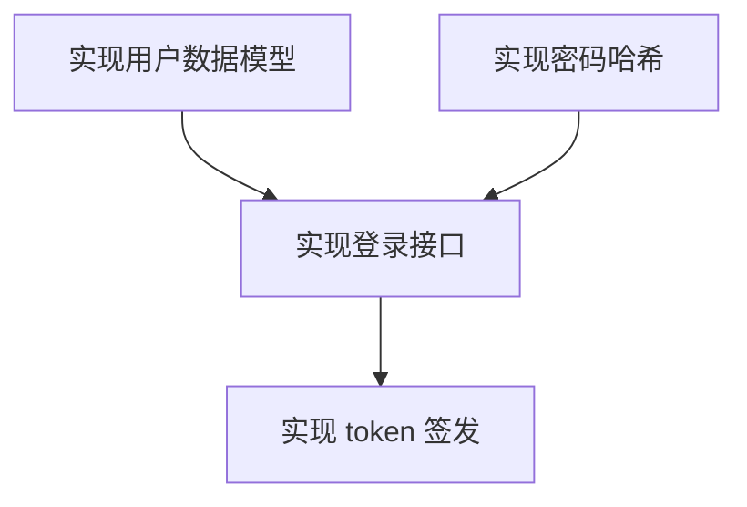

# <项目名称> — 任务拆解

<!-- SDD:SPEC:tasks -->

## 0. 元信息

| 项目 | <feature 名> |
|------|------|
| 版本 | v0.5 |
| 关联文档 | proposal.md, design.md |
| 任务总数 | <N> |
| 执行策略 | <串行 / 同批并行,批次划分规则> |
| 批次 | <M1> |

## 1. 任务列表

<!-- 粒度:一个 Task = 一组文件改动 + 一个可观测交付物 + 一条可执行验证命令。
     标题必须动词开头。验证命令是硬要求——阶段 4 靠它判定通过与否。
     完成状态写在标题里:待办为 `### TASK-001: 标题`,完成为 `### [x] TASK-001: 标题`。 -->

### TASK-001: <动词开头,例如「实现用户数据模型」>

- **描述**: <一两句,做什么、为什么>
- **输入**: 无 | `<依赖的前置产出:文件路径或接口签名>`
- **输出**: `<具体文件路径 / 接口 / 可观测行为>`
- **验收标准**: <二值化:只有通过和不通过,附可观测结果>
- **依赖**: 无 | TASK-xxx
- **验证命令**: `<可直接执行的命令,例如 pytest tests/models/test_user.py>`
- **验证结果**: `<任务完成后填:实际跑通的命令 + 关键输出,例如 12 passed。标成 [x] 之前不能留空>`

### TASK-002: <动词开头>

- **描述**: <...>
- **输入**: `<...>`
- **输出**: `<...>`
- **验收标准**: <...>
- **依赖**: TASK-001
- **验证命令**: `<...>`

## 2. 依赖关系图



## 3. 推荐执行顺序

<!-- 拓扑序 + 可并行组标注。编号顺序不等于执行顺序。 -->

```
批次 1 (可并行 [P]): TASK-001, TASK-002
批次 2: TASK-003
批次 3 (可并行 [P]): TASK-004
```

## 4. 追溯矩阵

<!-- 每条 proposal 的 AC 至少被一个 Task 覆盖。 -->

| AC | 覆盖的 Task |
|----|-------------|
| <AC-F-001> | TASK-003 |
| <AC-P-001> | TASK-004 |

## 5. 变更记录

| 日期 | 版本 | 变更 | 原因 | 影响 |
|------|------|------|------|------|
| <YYYY-MM-DD> | v0.5 | 完成 tasks 初稿 | — | — |
