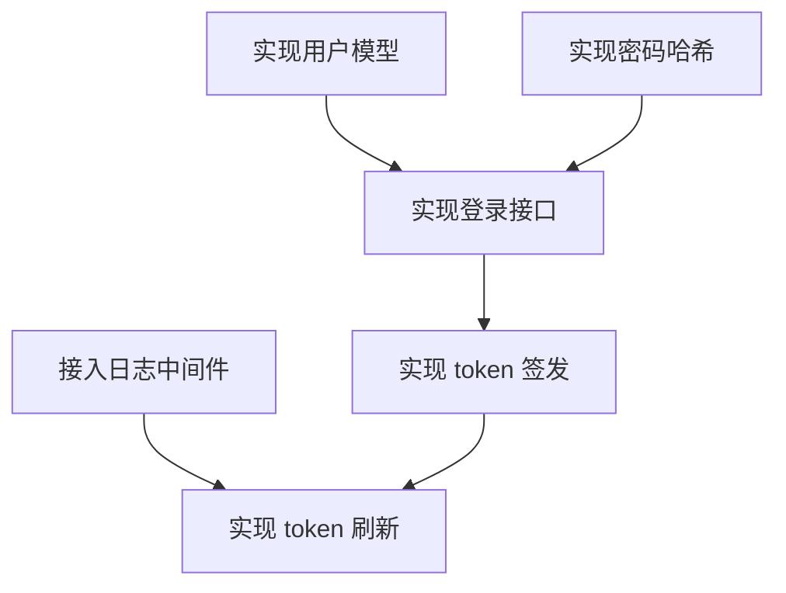

# Phase 3 — 任务拆解(tasks.md)

## 目标

把 design 转成**一张可执行的依赖图**:每个 Task 是一个有明确输入、明确输出、
**一条可执行验证命令**的最小工作单元。

粒度准则是:一个 Task = 一组文件改动 + 一个可观测的交付物 + 一条能跑出通过/不通过的命令。
粒度过粗则无法并行、无法定位失败;过细则管理成本超过收益。

## 输入

- `specs/<feature>/design.md`(必读:模块划分、接口签名、数据模型、ADR)
- `specs/<feature>/proposal.md`(取全部 AC,用于追溯)

## 输出

`specs/<feature>/tasks.md`,版本推进到 `v0.5`。

## AI 动作序列

### 1. 列出可交付物清单

从 design 的模块与接口推导出这批任务最终要交付什么:
接口实现、模块骨架、数据模型落地、配置与可观测性接入、测试、文档……
按模块分组,组内按依赖排序。

### 2. 拆 Task

每个 Task 填满七个字段:

| 字段 | 要求 |
|---|---|
| 编号 | `TASK-001` 连续 |
| 标题 | **动词开头**：「实现 token 签发」而非「token 签发」 |
| 描述 | 一到两句,说明做什么、为什么 |
| 输入 | 依赖的前置产出(具体到文件路径或接口签名) |
| 输出 | 具体的文件路径 / 接口 / 可观测行为 |
| 验收标准 | **二值化**:只有通过和不通过,附可观测结果 |
| 依赖 | 需要先完成的 Task 编号 |
| 验证命令 | 一条可直接执行的命令,如 `pytest tests/auth/test_token.py::test_issue` |

**验证命令是硬要求。** 阶段 4 靠它判定通过与否;没有命令的 Task 无法自动闭环。

拆 Task 时注意:
- 一个 Task **尽量只动一个模块**,这样才能安全并行
- 涉及同一批文件写入的 Task 放同一批,不并行
- 测试与实现放在同一个 Task 里(测试即交付物的一部分),除非测试需要跨 Task 的接口

### 3. 画依赖 DAG

用 mermaid 画:



同时给出**推荐执行顺序**(拓扑序),并用 `[P]` 标出可并行组:

```
批次 1 (并行): TASK-001, TASK-002, TASK-004
批次 2: TASK-003
批次 3 (并行): TASK-005
批次 4: TASK-006
```

### 4. 生成追溯矩阵

建立 AC → Task 的映射,确保没有落空的验收标准:

| AC | 覆盖它的 Task |
|---|---|
| AC-F-001 | TASK-003, TASK-005 |
| AC-P-001 | TASK-006 |

### 5. 校验与固化

`validate_specs.py --feature <feature>` → 0 错误 → **AskUserQuestion 确认后** git commit:
`docs(spec): 完成 <feature> tasks v0.5`

## Gate 检查清单

- [ ] Task 编号连续,无跳号
- [ ] 每个 Task 标题以动词开头
- [ ] 每个 Task 有明确的「输出」(文件路径或接口),可被下游 Task 当作输入
- [ ] 每个 Task 的验收标准二值化,且**附带一条可执行的验证命令**
- [ ] 依赖引用的 Task 均存在,**DAG 无环**
- [ ] 一个 Task 不跨模块(保证可并行);同文件冲突的 Task 不在同一并行组
- [ ] 每条 AC 至少被一个 Task 覆盖,无孤立 AC
- [ ] 规模适中:单批 ≤12 个 Task;超出则按 M1/M2 分批
- [ ] 推荐执行顺序与 DAG 一致,并标出了并行组

## 完成判据

`validate_specs.py` 0 错误;每个 Task 都能被一个不看对话上下文的 AI 独立执行
(有足够信息 + 有验证方式)。

## 常见坑

| 坑 | 表现 | 修正 |
|---|---|---|
| 任务过粗 | 「实现用户模块」 | 拆到有具体输出与验证命令 |
| 任务没有验证命令 | 靠肉眼判断做完了 | 补一条能跑的命令 |
| 验收标准不可二值 | 「代码质量良好」 | 改成可观测的具体结果 |
| 依赖成环 | A 依赖 B,B 依赖 A | 合并环内任务或调整边界 |
| 一个 Task 跨三个模块 | 无法并行,冲突多 | 按模块边界拆 |
| AC 没被覆盖 | 写完了但有需求没实现 | 追溯矩阵暴露,补 Task |
| Task 顺序 = 编号顺序 | 编号顺序与依赖顺序不一致 | 按拓扑序排,不按编号排 |
